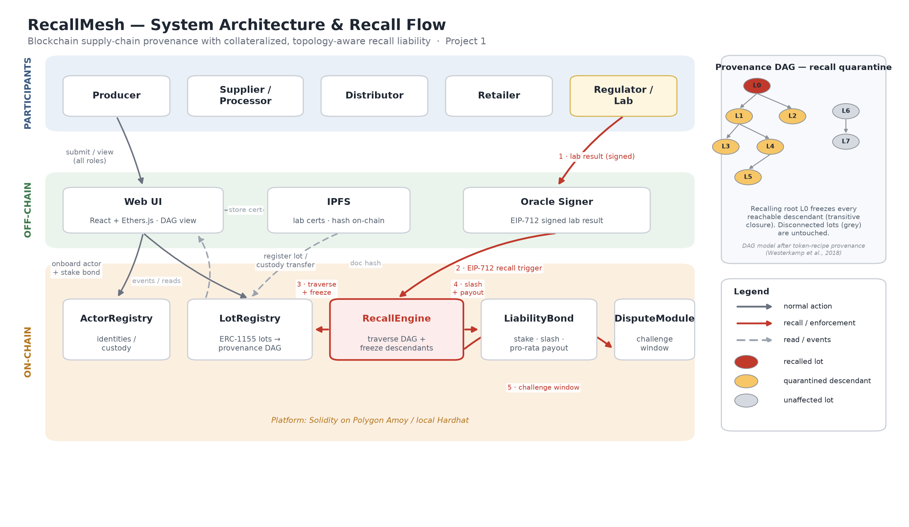

# RecallMesh — Architecture

*Figure 1. RecallMesh system architecture and recall data flow.*

## Layers

- **Participants** (mutually distrusting): producer, supplier/processor, distributor, retailer,
  and a regulator/accredited lab that may authorize recalls.
- **Off-chain:** a React/Ethers.js UI (provenance-graph view + one-click recall), an EIP-712
  **oracle signer** for lab results, and **IPFS** for certificates (only the hash goes on-chain).
- **On-chain (Solidity, Polygon Amoy / local Hardhat):** the five contracts below.

## Contracts & responsibilities

- **ActorRegistry** — identities and roles; gates who may create lots and who may sign recalls.
- **LotRegistry (ERC-1155)** — lots as tokens, each storing its parent lot IDs. Parent edges are
  recorded as child edges too, so descendants can be traversed. Holds lot status.
- **LiabilityBond** — neutral custody of staked bonds; slashes into a per-recall escrow and pays
  downstream holders pro-rata.
- **RecallEngine** — verifies the EIP-712 recall, computes affected descendants, quarantines them,
  slashes, opens a dispute, and finalizes payout. *This is where liability is keyed to topology.*
- **DisputeModule** — UMA-style challenge window so slashing isn't unilateral.

## Recall data flow (numbered in Figure 1)

1. Regulator/lab signs a lab result (EIP-712).
2. The signed recall is submitted to `RecallEngine.initiateRecall`.
3. RecallEngine traverses the DAG in `LotRegistry` and **freezes** the affected descendants.
4. RecallEngine **slashes** the at-fault actor's bond and escrows it, then (on finalize) pays
   downstream holders **pro-rata**.
5. The at-fault actor may contest in `DisputeModule` before settlement is final.

## Draft-stage limitations / planned work

- **Traversal gas.** `affectedDescendants` is a bounded BFS (`maxNodes` cap); it is O(n²) in the
  result size because a `view` cannot use a storage visited-set. For large graphs we plan a
  **Merkle-membership** proof of the affected set instead of on-chain traversal.
- **Bond sizing.** `slashAmount` is a placeholder; the report will analyze incentive-compatible
  bond sizing (bonds vs. real recall liability).
- **Dispute outcome.** `finalizeRecall` currently always pays out; if a dispute overturns the
  attribution it must instead **refund** the wrongly-accused actor (marked `TODO`).
- **Payout inputs.** `holders`/`weights` are computed off-chain from the `LotsQuarantined` event
  plus ERC-1155 balances and passed to `finalizeRecall`.
- **Trust assumptions.** The oracle (regulator/lab) and honest lot-creation data are trusted
  inputs; these are discussed as explicit limitations in the report.

## Prior art (and our delta)

Provenance DAGs [Westerkamp et al. 2018], bonded optimistic oracles [UMA], and token-freeze
standards [ERC-3643] exist separately. RecallMesh's contribution is tying **slashing + pro-rata
compensation to the provenance graph's topology** for recalls — the combination we could not find
in prior work.
